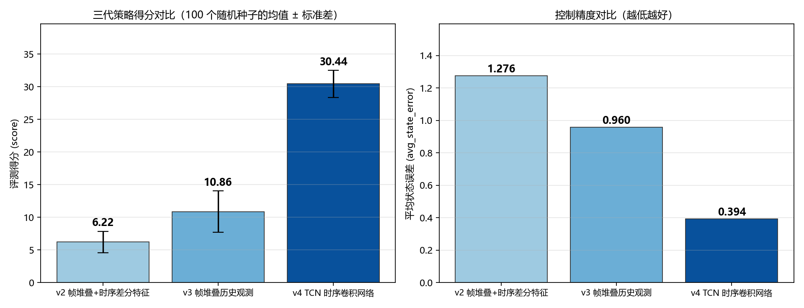
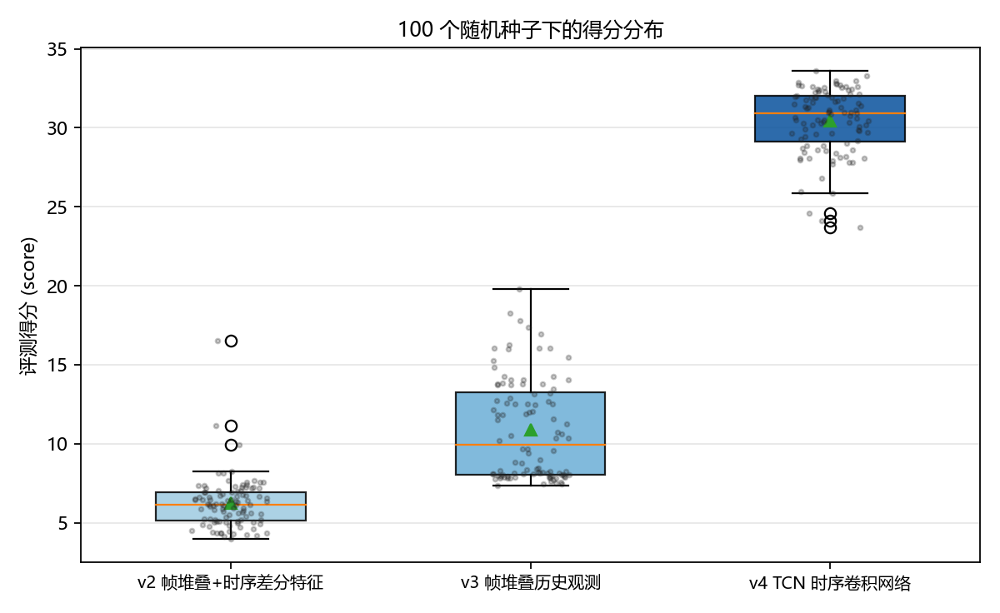

# Offline RL for Industrial Control

[](https://github.com/ffgxfvy/offline-rl-industrial-control/actions/workflows/ci.yml)
[](#测试与-ci)
[](pyproject.toml)

> 工业控制策略的离线强化学习：同一任务迭代三代策略网络，评测得分 **6.22 → 10.86 → 30.44**（各 100 个随机种子的均值），平均状态误差 **1.276 → 0.394**。



## 这是什么

一个工业控制策略评测任务的参赛作品。主办方提供一个工业控制环境 `IndustrialControlEnv` 与一份**完全离线**的轨迹数据集，参赛者需要在不与环境在线交互的前提下，提交一个策略模型；评测服务用累计奖励均值打分（提交包 ≤ 10 MB、单次评测限时 5 分钟、**评测环境无网络**）。

**离线设定是这个任务的核心难点**：策略只能从固定数据集里学习，无法通过试错修正，因此必须显式处理"分布外动作的价值过估计"问题——这也是本项目全程使用 **CQL（Conservative Q-Learning）** 的原因。

## 结果

| 版本 | 时序建模方式 | 得分均值 | 最高 | 最低 | 标准差 | 累计奖励均值 | 平均状态误差 |
|---|---|---|---|---|---|---|---|
| v2 | 帧堆叠 + 手工时序差分特征 | 6.224 | 16.552 | 3.955 | 1.63 | −3228.1 | 1.2758 |
| v3 | 帧堆叠历史观测（端到端） | 10.862 | 19.812 | 7.338 | 3.17 | −2689.8 | 0.9596 |
| v4 | **TCN 时序卷积网络** | **30.442** | 33.590 | 23.711 | 2.07 | **−1602.6** | **0.3935** |

> 每个版本均以 **100 个随机种子**（seed 0–99）完整跑完评测，上表为统计结果而非单次最优。原始数据见 `results/*/evaluation_results.csv`。



**三代的关键变化：**

1. **v2 → v3：手工特征 vs 端到端。** v2 在帧堆叠之外手工计算历史窗口的均值与标准差作为额外特征（`EnhancedHistoryManager`）；v3 改为纯帧堆叠，让网络自己从历史观测里学表征（`HistoryManager`）。得分从 6.22 涨到 10.86，但**标准差从 1.63 涨到 3.17**——说明前馈网络很难从堆叠帧中学出稳定的时序结构。
2. **v3 → v4：换上显式时序建模。** v4 用 TCN（因果卷积 + 残差连接 + Dropout）替代前馈网络，并显式实现感受野计算。得分跃升到 **30.44（×4.9）**，状态误差降到 **0.39（÷3.2）**，同时**标准差回落到 2.07**——更强且更稳。

**这个"分数上去了但方差变大 → 判断是时序建模不足 → 换成 TCN → 分数质变且方差收敛"的推理链，是本项目最有价值的部分。** 详细的技术细节与实验动机见 [`docs/iterations.md`](docs/iterations.md)。

## 网络与训练要点

**观测/动作定义**：单帧观测 5 维，动作 3 维（连续，`tanh` 输出并裁剪到 `[-1, 1]`）。历史长度 30 帧 ⇒ v2/v3 的输入维度为 150。

**CQL 是全程的基础算法**（抑制离线数据上的 Q 值过估计）：

```
L_CQL = α · ( logsumexp_a Q(s, a) − Q(s, a_π) ) + ½ · ( Q(s,a) − y )²
y = r + γ · (1 − done) · Q_target(s', π_target(s'))
```

**TCN 结构**（v4，见 `src/gen4_tcn_agent.py`）：
- `TemporalBlock` = 因果卷积（`padding = (k−1)·d`）+ `Chomp1d` 裁剪右侧填充 + 残差连接 + Dropout 0.2；
- 通道配置 `[64, 128, 64]`，卷积核 `kernel_size=3`；
- `calculate_receptive_field(kernel_size, num_levels)` 显式计算感受野，用于确认覆盖到足够的决策步数；
- `TCNPolicyNetwork` 把 TCN 输出接池化与 MLP 头，输出 3 维动作。

**其他实现变体**（`src/variants/`，不同时期的探索）：

| 文件 | 结构 | 特点 |
|---|---|---|
| `cql_gru_agent.py` | GRU Actor/Critic + CQL | 早期提交版，用 GRU 编码 30 帧历史 |
| `conservative_cql_agent.py` | `ConservativeMLP` + `ConservativeCQLTrainer` | **极端保守初始化**（输出层权重 `U(-0.001, 0.001)`、`gain=0.5`），ELU 防死神经元，`cql_weight=5.0`、`temperature=5.0`、早停 `patience=5` |
| `final_mlp_cql_agent.py` | `FinalMLP (256,128)` + `FinalCQLTrainer` | 双 Q 网络 + 目标网络软更新 `tau` |
| `improved_cql_agent.py` | `StableNetwork` + `ImprovedCQL` | 用 `logsumexp` 实现 CQL 损失，`cql_weight=0.5` |

## 目录结构

```
.
├── src/
│   ├── gen2_td_agent.py            # v2：帧堆叠 + 时序差分特征
│   ├── gen3_history_agent.py       # v3：帧堆叠历史观测
│   ├── gen4_tcn_agent.py           # v4：TCN 时序卷积（本项目最佳）
│   └── variants/                    # 其他探索版本
├── training/
│   └── train_cql_gru.py            # CQL + GRU 训练脚本（离线数据集全流程）
├── scripts/
│   ├── evaluator.py                # 本地评测器（评测服务端的同构实现）
│   └── plot_evolution.py           # 复现 README 中两张图
├── tests/                           # 64 个 pytest 测试（含因果性不变量检查）
├── results/
│   ├── gen2_td/evaluation_results.csv
│   ├── gen3_history/evaluation_results.csv
│   └── gen4_tcn/evaluation_results.csv
├── assets/                          # 结果图
├── data/                            # 数据字段说明（完整数据集未公开，见 data/README.md）
├── .github/workflows/ci.yml         # CI：跑测试 + 重新生成对比图
├── CHANGELOG.md                     # 工程化改动记录（含一处边界 bug 修复）
└── pyproject.toml
```

## 快速开始

```bash
git clone https://github.com/ffgxfvy/offline-rl-industrial-control.git
cd offline-rl-industrial-control
pip install -r requirements.txt

# 1) 复现 README 中的对比图（无需完整数据集，results/ 里已有三份评测记录）
python scripts/plot_evolution.py

# 2) 本地评测（需要把 data.csv 放到 data/ 下）
python scripts/evaluator.py --agent src/gen4_tcn_agent.py

# 3) 重新训练（见 training/train_cql_gru.py 顶部配置区）
python training/train_cql_gru.py
```

## 环境

`python>=3.8`、`torch`、`numpy`、`pandas`、`matplotlib`。见 `requirements.txt`；原始环境见 `training/environment.yaml`（已按提交要求锁定）。

## 测试与 CI

```bash
pip install -r requirements.txt -r requirements-dev.txt
pytest tests -v
```

**64 个测试**，按"这些代码真的会在线上被调用"的假设来写，覆盖四类风险：

| 测试文件 | 守的是什么 |
|---|---|
| `test_tcn_architecture.py` | **因果性不变量**——扰动 `t` 时刻的输入，不得改变 `t` 之前任何时刻的输出。如果 `Chomp1d` 被误删或 padding 算错，离线评测可能仍跑得出不错的分数，但在线部署会不可解释地崩掉。同时覆盖感受野公式、残差投影、输出维度。 |
| `test_history_managers.py` | 三代历史/序列管理器的维度与**时间顺序**语义（旧 → 新）。 |
| `test_agent_interface.py` | 评测服务依赖的 `BaseAgent` 契约：动作维度 `(3,)`、裁剪到 `[-1,1]`、观测放大 100 倍仍合法、同种子可复现、`reset`/`close` 幂等、动作对观测敏感（防止策略退化成常量）。 |
| `test_results.py` | `results/*/evaluation_results.csv` 的数据契约：100 个 seed、列名、无缺失、三代得分单调提升。**README 里的结论若被数据推翻，这里会先报警。** |
| `test_plot_backend.py` | 绘图脚本可运行，且输出的三代均值与 README 一致。 |

CI（`.github/workflows/ci.yml`）在 Python 3.9 / 3.11 上各跑一遍，并重新生成对比图作为冒烟测试，产物作为 artifact 上传。

> 为作品集整理时发现并修复了一处边界缺陷（`Chomp1d` 在 `chomp_size == 0` 时返回空张量而非恒等映射），详见 [`CHANGELOG.md`](CHANGELOG.md)。该修复对 `kernel_size > 1` 的路径行为完全不变，已训练权重不受影响。

## 我负责的部分

单人项目。数据预处理、CQL 损失实现、三代策略网络设计、超参调优、100 seeds 评测与结果分析均由本人完成。任务环境与数据集由竞赛主办方提供。

## 相关文档

- [`docs/iterations.md`](docs/iterations.md) —— 三代迭代的完整技术记录（**推荐先读这个**）
- [`docs/competition-faq.md`](docs/competition-faq.md) —— 备赛期间整理的工程问题排查记录
- [`data/README.md`](data/README.md) —— 数据集字段与获取说明
